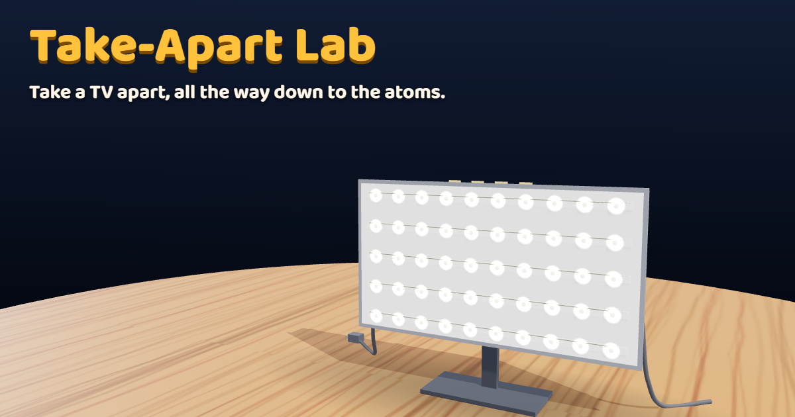

# Take-Apart Lab



**Play it:** https://coachatlus.github.io/take-apart-lab/ (works on an iPad: Share, then Add to Home Screen)

A 3D take-it-apart game for a 5-year-old. Pick a device, spin it around, tap parts to pull them out, and watch what breaks. A friendly voice explains each part. A "Fix-it mission" breaks one part; the kid reads the symptom and finds it.

Devices so far, with pieces at Beginner / Medium / Advanced. Advanced is a real teardown: every board, module and switch comes apart into its own pieces.

- Old Tube TV: 10 / 34 / 100
- Flat LED TV: 21 / 109 / 266
- Flashlight: 6 / 16 / 36
- TV Remote: 7 / 22 / 47 (the invisible infrared flash shows up on a phone camera)
- Toaster: 7 / 22 / 55 (glowing wires, a browning dial, toast that pops)
- Solar Garden Light: 6 / 22 / 48 (a Day/Night dial charges and drains the battery)
- Toy Car: 7 / 22 / 58 (motor, gears and wheels turn)
- Doorbell: 5 / 18 / 47 (an electromagnet goes ding-dong)
- Game Controller: 8 / 26 / 79 (rumble motors shake it)
- Phone: 6 / 30 / 84

Sparky, a talking robot, walks the kid through each device step by step: a glowing ring shows what to touch, an arrow shows which way to drag, and he nudges if nothing happens for a while.

## Play

- iPad: open the GitHub Pages link in Safari, tap Share, then **Add to Home Screen**. It opens full screen like an app and works offline after the first visit.
- Sound: Sparky uses the device's built-in reader. Tap **Sound check** on the start screen. No sound on an iPad usually means Silent mode (the bell in Control Center) or the volume.
- PC: double-click `Play.bat` (opens `index.html` in your browser). No install, no server.
- Drag a part with a finger to pull it out (any direction works). Tap a pulled-out board to look closer and pick its pieces off.
- Needs internet the first time for the font; three.js falls back to `vendor/three.min.js` offline.
- Keys: `P` power, `C` channel, `X` x-ray, `Esc` back to devices.
- Link straight to a device with `index.html#crt-tv`, `#led-tv`, `#flashlight`, `#remote`, `#toaster`, `#solar-light`, `#toy-car`, `#doorbell`, `#controller` or `#phone`.

## Going deeper

- **Look inside:** tap the **Look inside** button and everything with an inside glows blue and gets a tag. Tap one to shrink down inside it (or touch a part and tap its floating Look inside badge). There are 34 inside views, several levels deep, and almost every one has an experiment to try (a dial or a part to pull) with a result to watch. For example:
  - LED light > LED (20x) > LED chip (1,000x) > atoms making light (1,000,000x)
  - processor chip (10x) > the silicon (100x) > one transistor (1,000,000x) > silicon atoms (100,000,000x)
- Others: wire > copper atoms, screw, resistor, fuse (watch the wire melt), magnet, heat sink, switch, circuit board, diode, battery and its chemistry, capacitor and its plates, LCD pixel and liquid crystal, speaker, transformer, and the picture tube and its phosphor dots.
- The trail at the top shows where you are, and **Back** climbs out one level.
- **Every pull teaches something:** if the device stops working, Sparky says what broke. If it still works, he says "Still works!" and what the part is for.

## Games

Tap **Games** on any device or inside view:

- **Must-have parts:** every part turns red (it stops working without it), orange (it still works, but something changes) or green (nothing changes), with colored tags. The critical path at a glance.
- **Guess first:** before a piece comes off, guess whether it will still work.
- **Find it!:** Sparky names a part to find; every third round, find a must-have part.
- **Rebuild race:** it all comes apart, then put it back together against the clock (inside pieces first). Best times are saved.
- **My parts book:** every part found on every device, every inside view visited, and badges.

The Fix-it mission (a broken part, a symptom, find it and replace it) works on every device.

## Accuracy

The teaching text was written by AI models, then fact-checked twice: one model checked about 900 claims (against web sources for anything specific) and fixed 32, and a second, different model independently re-checked those fixes and the claims the first couldn't verify. Details in `VERIFICATION.md`.
- **Tell me more:** each tap goes one level deeper: For kids, How it works, How it's built, The science, Deep dive. The deeper levels live in `js/learn.js`, keyed by part name.
- Drag up or down to look from above or underneath. The table turns with the device and fades away when you look from below.
- Drag a loose piece to slide it around the table. Zoom with a pinch or the + and - buttons; zooming in centers on the last piece you touched.

## How it's built

- `js/engine.js`: scene, camera, tapping, part animation, sound (all synthesized), speech, TV shows, particles, missions.
- `js/devices/*.js`: one file per device. Each calls `TAL.registerDevice({...})`.
- `js/worlds.js`: the zoomed-in worlds (`TAL.registerWorld`, same format as a device, plus `zoom`, `fixed` parts and inline `learn`). `TAL.insideByName` maps part names to worlds; a part can also set `inside: 'world-id'`.
- `js/learn.js`, `js/learn-deep.js`: deeper explanations by part name (`TAL.learn`, `TAL.deep`), "tell me more" for intros (`TAL.introMore`), and what non-essential parts are for (`TAL.jobs`).
- `tools/`: `start-test.sh` + `shoot.mjs` drive headless Chrome; `regress.js` opens every device, level, inside view and game and reports errors.
- three.js r128 as a plain global (`THREE`), so it all works from `file://` with no build step.

## Add a device

1. Copy `js/devices/flashlight.js` (simplest) to a new file.
2. Add a `<script src="js/devices/your-device.js"></script>` line at the bottom of `index.html`.

A device is:

```js
TAL.registerDevice({
  id: 'radio', name: 'Radio', short: 'radio', subtitle: 'Shown on the start card',
  powerSound: 'click',              // 'crt' | 'flat' | 'click'
  channels: false,                  // true shows the Channel button
  screenStyle: 'crt' | 'flat',      // only if it has a screen; screenPart = id of the part that holds it
  view: { target: [0, 1.5, 0], radius: 4, explodedRadius: 6, explodedY: 2, yaw: -0.4, pitch: 0.25, shadow: [5, 3] },
  intro: 'Spoken when it opens.',
  shellSay: 'Spoken when the kid taps the non-removable case.',

  build(k) {                        // k = kit: box, cyl, sphere, torus, tube, board, screw, decal, screen, mat, metal, glass, glow, at, rot, group
    const root = k.group();
    // ...make meshes; add the parts' groups to root (or to a child group with no rotation)
    return {
      root,
      shell: [caseGroup],           // not removable; goes see-through with X-ray
      parts: [{
        id: 'battery', name: 'Battery', obj: batteryGroup,
        pull: [2, 0, 1],            // where it flies when pulled out (offset)
        blockedBy: ['cover'],       // must be removed first
        kind: 'screw',              // optional: unscrew animation
        xray: true,                 // optional: goes see-through with X-ray (covers)
        noSpark: true,              // optional: no sparks when pulled while on (plugs, cables)
        parent: 'board',            // optional: this piece sits on another part (its obj is nested in the parent's obj)
        reach: ['cover'],           // on a parent: what blocks touching its pieces while it's still in (default: blockedBy)
        face: [0, 0, -1],           // which way the part faces, so "look closer" turns it toward you
        focusRadius: 1.4,           // how close "look closer" zooms
        breaksAlways: true,         // say the `breaks` line even if nothing visible changes
        level: 2,                   // 1 Beginner (default), 2 Medium, 3 Advanced: the first level where this is its own piece
        fuse: 'cover',              // below its level, ride along inside this part (nested pieces stay in their parent anyway)
        say: 'What it is, for a 5-year-old.',
        breaks: 'What stops working if you pull it while it is on.',
        fact: 'The "Tell me more" line.',
        symptom: 'If set, this part can be the broken one in a Fix-it mission.',
        learn: ['Level 2 ...', 'Level 3 ...', 'Level 4 ...'], // Tell me more, deeper each tap (aim for 3+)
        job: 'What it is for. Said as "Still works! ..." when pulling it changes nothing.',
        onTap: (inst) => {},        // optional, for fixed parts: do something when tapped (a knob, a dial)
      }],
      screen,                       // from k.screen(...), optional
      refs: {},                     // anything apply() needs
    };
  },

  // has(id) is false when a part is pulled out (or is the mission's broken part).
  evaluate(has, on) {
    return { alive: on && has('battery'), reason: 'Spoken if it will not turn on', screen: { mode: 'picture' }, sound: { show: true } };
  },

  // optional: a step dial instead of the Power button (read inst.def.dial.steps[inst.dial || 0] in tick)
  dial: { label: 'Electricity', steps: [{ name: 'Off', level: 0, say: '...' }, { name: 'Full', level: 1, say: '...' }] },

  apply(out, inst) { /* optional: light LEDs, show beams, etc. from out */ },
  tick(dt, t, inst, out) { /* optional: per-frame animation */ },

  // Sparky's walkthrough. Steps: power, remove {ids}, removeAny {ids}, turn {side:'back'}, focus {id}, end.
  // A step can say `levels: [1]`; ids that aren't pieces at the current level are dropped, and empty steps skipped.
  guide: [
    { do: 'power', say: 'Press the green power button.', nudge: 'Said again if nothing happens for a while.' },
    { do: 'remove', ids: ['cover'], say: 'Pull off the back cover.' },
    { do: 'end', say: "Now you're the boss!" },
  ],
});
```

Screen modes: `off`, `black`, `picture`, `snow`, `dot`, `line`, `vline`, `nosignal`, `white`, plus `glitch`, `gray`, `invert`, `tint` (a color like `#00ffff`), `blotch`, `blur`, `hotspots`, `deadCols` (column indexes of 4), `darkRows` (row indexes of 5, from the bottom) and `dim` (0 to 1). Sound: `show`, `hiss`, `left`, `right`.

The LED TV (`js/devices/led-tv.js`) is the worked example of a big device: board builders, nested pieces, role-based breakage.

Ideas for next devices: radio, desk fan, game controller, toaster, phone, keyboard.
